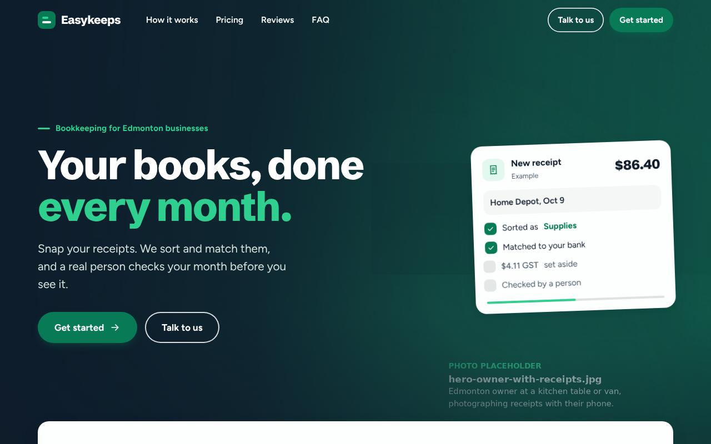

# Easykeeps website

The landing page for Easykeeps, a small-business bookkeeping service, published at [easykeeps.ca](https://easykeeps.ca).



## What it is

- One landing page in plain HTML, CSS and JavaScript, with no build step and no libraries.
- Separate phone layouts for the hero, "How it works", the photo story and pricing, tested at 375px, 1280px and 1920px.
- Pinned scroll scenes, animated sample charts and a pricing toggle, all of which stop when the visitor's device asks for reduced motion.
- An accessibility panel for bigger text, stronger contrast, underlined links, more line spacing and stopping motion, remembered per device.
- Self-hosted fonts and a contact form that falls back to a copyable email address if the send fails.

## Tech stack

HTML, CSS, JavaScript, GitHub Actions and GitHub Pages.

## Run it locally

```bash
cd landing
python3 -m http.server
```

Then open http://localhost:8000.

## Publishing

Every push to `main` that changes `landing/` publishes the page to GitHub Pages through `.github/workflows/pages.yml`. `landing/README.md` has the content placeholders and the publishing checklist.
